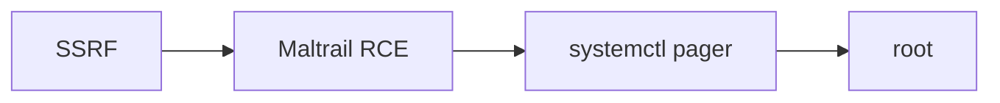

# Hướng dẫn viết & đăng bài — OhMyBlog

Site: <https://ohmyblog-plogplus.pages.dev> · Repo: `~/CODE/App/blog`

Luồng tổng quát:

```
viết .md (draft) → xem trước local → prepublish-check → bỏ draft → git push
→ GitHub Actions (gitleaks + OPSEC + lint + build) → Cloudflare Pages
```

> Lệnh `pnpm` dưới đây có thể thay bằng `npx -y pnpm@11.3.0` nếu máy chưa cài pnpm global.

---

## 1. Chọn loại bài & template

| Muốn viết             | Template                      | `kind`     | Hiện ở trang |
| --------------------- | ----------------------------- | ---------- | ------------ |
| Write-up CTF          | `templates/ctf-writeup.md`    | `writeup`  | Write-ups    |
| HTB / THM / VulnLab   | `templates/htb-machine.md`    | `writeup`  | Write-ups    |
| Phân tích CVE         | `templates/research-cve.md`   | `research` | Research     |
| Ghi chú, cheatsheet   | `templates/notes.md`          | `notes`    | Posts        |
| Bài thường            | (tự viết)                     | `post`     | Posts        |

Mọi bài (trừ draft) đều xuất hiện ở trang **Posts**, **Tags**, **Archives** và **Search**.

## 2. Tạo file

```bash
cd ~/CODE/App/blog
cp templates/htb-machine.md src/content/posts/htb-sau.md
```

- Tên file = URL: `htb-sau.md` → `/posts/htb-sau/`. Dùng chữ thường, kebab-case, không dấu.
- Có thể nhóm vào thư mục con: `src/content/posts/htb/sau.md`.
- File bắt đầu bằng `_` (vd `_ideas.md`) sẽ bị bỏ qua — dùng để nháp ý tưởng.

## 3. Frontmatter

### Trường chung (mọi bài)

```yaml
---
title: "HTB: Sau"
description: "SSRF in request-baskets to Maltrail RCE, then systemctl pager to root."
pubDatetime: 2026-11-20T09:00:00+07:00
modDatetime: 2026-12-01T10:00:00+07:00 # chỉ thêm khi sửa bài đã đăng
kind: writeup
tags: [ssrf, command-injection, linux]
draft: true # đang viết; xoá dòng này khi đăng
featured: false # true = ghim ở trang chủ
comments: true # false = tắt giscus cho bài này
hideToc: false # true = ẩn mục lục
ogImage: ../../assets/images/htb-sau/cover.png # tuỳ chọn, ảnh khi share link
---
```

| Trường        | Bắt buộc | Ghi chú                                                     |
| ------------- | -------- | ----------------------------------------------------------- |
| `title`       | ✔        |                                                             |
| `description` | ✔        | 1–2 câu, dùng cho SEO và thẻ preview — viết cho tử tế       |
| `pubDatetime` | ✔        | Có múi giờ `+07:00`. Ngày trong tương lai vẫn hiện, cẩn thận |
| `tags`        |          | **Chỉ** chữ thường kebab-case: `active-directory`, không `Active Directory` |
| `kind`        |          | `writeup` \| `research` \| `notes` \| `post` (mặc định `post`) |

### Trường cho write-up

```yaml
kind: writeup
platform: htb # htb | thm | ctf | portswigger | vulnlab | other   (bắt buộc)
category: web # web | pwn | rev | crypto | forensics | malware | ad | cloud | osint | mobile | hardware | misc   (bắt buộc)
event: "Machine: Sau" # hoặc "HTB Cyber Apocalypse 2026"
difficulty: easy # easy | medium | hard | insane
os: linux # linux | windows | other
points: 450 # CTF
retired: true # BẮT BUỘC với htb/thm/ctf/vulnlab khi bỏ draft
```

> [!warning]
> Build sẽ **fail** nếu write-up `htb/thm/ctf/vulnlab` không có `draft: true` và cũng không có `retired: true`.
> Chỉ đặt `retired: true` khi máy đã retire / CTF đã kết thúc và BTC cho phép công bố.

### Trường cho research

```yaml
kind: research
category: web
cve: [CVE-2026-12345] # định dạng CVE-YYYY-NNNN+
mitre: [T1190, T1059.004] # MITRE ATT&CK technique IDs
```

Giá trị sai (vd `category: Web`, `platform: hackthebox`, tag có chữ hoa) → build báo lỗi ngay, không tự tạo danh mục mới. Muốn thêm giá trị mới thì sửa danh sách trong `src/content.config.ts`.

## 4. Viết nội dung

### Code

````md
```console
$ nmap -sCV 10.10.11.224
PORT   STATE SERVICE
22/tcp open  ssh
```

```python file="exploit.py"
import requests
r = requests.get(url)  # [!code highlight]
token = "x"            # [!code --]
token = get_token()    # [!code ++]
```
````

- `file="exploit.py"` → hiện nhãn tên file trên code block.
- `// [!code highlight]`, `[!code ++]`, `[!code --]` (comment đúng cú pháp của ngôn ngữ) → tô sáng dòng / diff.

Ngôn ngữ hay dùng: `console`, `bash`, `powershell`, `python`, `c`, `asm`, `js`, `http`, `sql`, `yaml`, `diff`.

### Callout

```md
> [!note]
> Thông tin phụ.

> [!tip] Tiêu đề tuỳ chỉnh
> Mẹo.

> [!warning]
> Cảnh báo.

> [!success]- Flag
> `HTB{...}` ← dấu `-` = thu gọn mặc định, dùng để giấu flag/spoiler
```

Các loại khác: `info`, `todo`, `question`, `failure`, `danger`, `bug`, `example`, `quote`, `abstract`.

### Sơ đồ Mermaid

````md

````

### Ảnh

Đặt ảnh trong `src/assets/images/<tên-bài>/`, tham chiếu bằng đường dẫn tương đối:

```md

```

- Astro tự nén / resize; bấm vào ảnh để zoom.
- Không muốn zoom: dùng HTML ``.
- **Che** IP thật, hostname nội bộ, token, email trong screenshot trước khi commit.
- Ảnh trong `public/` không được tối ưu — chỉ dùng cho file cần URL cố định.

### Bảng, link, mục lục

- Mục lục tự sinh từ heading `##` / `###`.
- Link nội bộ: `[xem bài AD](/posts/ad-kerberoasting/)`, `[write-up HTB](/writeups/?platform=htb)`.
- Bảng Markdown thường; bảng rộng tự cuộn ngang trên mobile.

## 5. Xem trước

```bash
pnpm dev
# http://localhost:4321
```

Bài `draft: true` **có** hiện ở dev nhưng **không** được build lên production.

Muốn chạy giống production (kèm CSP headers):

```bash
pnpm build
npx wrangler pages dev dist   # http://127.0.0.1:8788
```

## 6. Kiểm tra trước khi đăng (OPSEC)

```bash
bash scripts/prepublish-check.sh             # quét toàn bộ nội dung
bash scripts/prepublish-check.sh --fix-exif  # xoá EXIF/GPS khỏi ảnh
pnpm format                                  # format, CI sẽ fail nếu chưa format
pnpm lint
```

| Mức    | Ý nghĩa                                                    | Làm gì                      |
| ------ | ---------------------------------------------------------- | --------------------------- |
| `HIGH` | Secret/key, write-up chưa retire, ảnh còn EXIF             | Bắt buộc sửa, CI sẽ chặn    |
| `WARN` | IPv4, hostname nội bộ, email, chuỗi giống flag/hash 32 hex | Đọc từng dòng, tự quyết định |

Checklist thủ công:

- [ ] Không lộ IP/hostname/username của công ty, khách hàng, VPN cá nhân.
- [ ] Không có token, cookie, API key thật (kể cả trong ảnh, trong output `curl -v`).
- [ ] Flag của CTF đang diễn ra / máy chưa retire: **không** đăng.
- [ ] Không đăng chi tiết lỗ hổng chưa được vá / chưa hết thời hạn disclosure.
- [ ] Ghi credit tác giả challenge, nguồn tham khảo.
- [ ] Nội dung về hệ thống thật: phải có ủy quyền / thuộc chương trình bug bounty cho phép công bố.

## 7. Đăng

Xoá `draft: true` (và đặt `retired: true` nếu là write-up), rồi:

```bash
git add src/content/posts/htb-sau.md src/assets/images/htb-sau/
git commit -m "Post: HTB Sau"
git push
gh run watch          # theo dõi deploy, ~2–3 phút
```

Sau khi xong, kiểm tra bài trên <https://ohmyblog-plogplus.pages.dev/posts/htb-sau/>.

> Nhánh `main` có ruleset `protect-main`: bạn là admin nên push thẳng được. Muốn làm chuẩn hơn thì
> `git switch -c post/htb-sau` → push → `gh pr create` → đợi check `build` xanh → merge.

## 8. Sửa / gỡ bài

| Muốn                | Làm                                                         |
| ------------------- | ----------------------------------------------------------- |
| Sửa nội dung        | Sửa file, thêm/cập nhật `modDatetime`, push                  |
| Tạm ẩn              | Đặt lại `draft: true`, push                                  |
| Xoá hẳn             | `git rm` file + ảnh, push                                    |
| Đổi URL             | Đổi tên file — link cũ sẽ 404, nên hạn chế sau khi đã đăng   |

Lưu ý: Git giữ lịch sử. Nếu lỡ đẩy secret lên, **xoay (rotate) secret ngay** — xoá file không đủ.

## 9. Lỗi thường gặp

| Lỗi khi build / CI                          | Nguyên nhân & cách sửa                                     |
| ------------------------------------------- | ---------------------------------------------------------- |
| `tags must be lowercase kebab-case`         | Đổi tag thành `active-directory`, `sql-injection`...        |
| `set retired: true ... or keep draft: true` | Write-up HTB/THM/CTF chưa đánh dấu retired                  |
| `write-ups need a platform/category`        | Thiếu `platform` hoặc `category`                            |
| `Invalid enum value`                        | Giá trị không nằm trong danh sách ở mục 3                   |
| `pubDatetime: Expected date`                | Sai định dạng, dùng `2026-11-20T09:00:00+07:00`             |
| `Could not find image`                      | Sai đường dẫn tương đối của ảnh                             |
| Job `format` fail                           | Chạy `pnpm format` rồi commit lại                           |
| Job `gitleaks` fail                         | Có chuỗi giống secret — xoá/che, nếu là secret thật thì rotate |
| Mermaid không hiện                          | Kiểm tra cú pháp ở <https://mermaid.live>                   |

## 10. Mẹo

- Viết nháp ngay trong lúc làm lab, giữ `draft: true`; đăng khi máy retire.
- `description` tốt = 1 câu tóm tắt chuỗi khai thác. Nó hiện trên Google và khi share link.
- Tag ít mà đều: tái sử dụng tag cũ (xem `/tags/`) thay vì tạo tag gần giống.
- Bài dài nhiều phần: dùng cùng 1 tag series (vd `home-lab`) để gom lại.
- Bình luận (giscus) dùng GitHub Discussions của repo; cần cài app tại <https://github.com/apps/giscus> nếu chưa.
