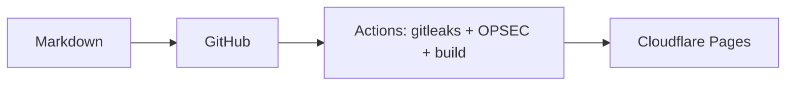

First post. Pipeline:



```console
$ pnpm build
[csp] 12 pages, 3 inline script hash(es) -> dist/_headers
```

> [!note]
> Every inline script is hashed into the CSP at build time.

> [!success]- Flag
> `FLAG{example_only}`
