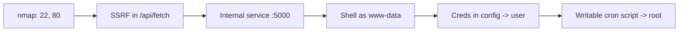

## Box info

| Field          | Value                                  |
| -------------- | -------------------------------------- |
| Name           | MachineName                            |
| OS             | Linux                                  |
| Difficulty     | Medium                                 |
| Released       | YYYY-MM-DD                             |
| Retired        | YYYY-MM-DD                             |
| Creator        | creator (credit them)                  |
| IP             | 10.10.11.xxx (lab IP — fine to show)   |

## Attack path



## Enumeration

```console
$ nmap -sC -sV -oA nmap/initial 10.10.11.xxx
PORT   STATE SERVICE VERSION
22/tcp open  ssh     OpenSSH 9.x
80/tcp open  http    nginx 1.24
```

Explain what stood out and what you ignored (and why).

## Foothold

Vulnerability → proof → shell. Keep payloads readable.

```bash
curl -s 'http://target.htb/api/fetch?url=http://127.0.0.1:5000/'
```

## User

```console
www-data@target:~$ cat /var/www/app/.env
DB_PASSWORD=<redacted>
```

> [!success]- user.txt
> `<redacted — HTB flags rotate, never publish real hashes>`

## Privilege escalation

```console
user@target:~$ ls -l /opt/backup.sh
-rwxrwxr-x 1 root user 230 ... /opt/backup.sh
```

> [!tip]- Spoiler: the intended path
> Explain the intended path if you used an unintended one (or vice versa).

## Technique summary (MITRE ATT&CK)

| Phase                | Technique                                 | ID        |
| -------------------- | ----------------------------------------- | --------- |
| Initial Access       | Exploit Public-Facing Application         | T1190     |
| Credential Access    | Unsecured Credentials: Credentials In Files | T1552.001 |
| Privilege Escalation | Scheduled Task/Job: Cron                  | T1053.003 |

## Detection & remediation

- How a blue team could catch each step (log source / query idea).
- What the root-cause fix is for each vulnerability.

## Lessons learned

- ...
