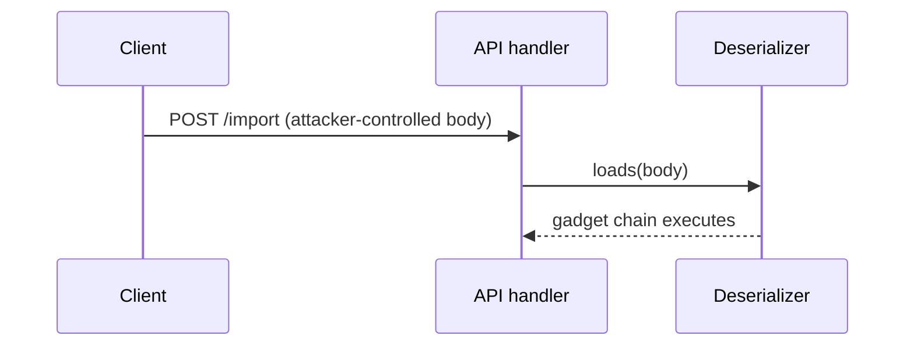

> [!warning]
> This analysis covers a vulnerability that has been **publicly disclosed and patched** (fixed in x.y.z, released YYYY-MM-DD).
> The proof-of-concept is limited to demonstrating the bug in a local lab. Do not test systems you are not authorized to test.

## Summary

| Field            | Value                                              |
| ---------------- | -------------------------------------------------- |
| CVE              | CVE-YYYY-NNNNN                                     |
| Product          | Vendor Product                                     |
| Affected         | `>= a.b.c, < x.y.z`                                |
| Fixed in         | x.y.z                                              |
| CVSS             | 9.8 (vendor / NVD vector: `CVSS:3.1/AV:N/...`)    |
| Class            | CWE-502 Deserialization of Untrusted Data          |
| Exploited in wild| yes / no / unknown (cite CISA KEV if listed)       |
| Credit           | original researcher (link)                         |

Three-sentence summary for people who will read nothing else.

## Impact & scope

Who is affected, preconditions (auth? config? network position?), realistic impact.

## Lab setup

```bash file=docker-compose.yml
# exact vulnerable + fixed versions so readers can reproduce
```

## Root cause analysis

### Patch diff

```diff
-    obj = pickle.loads(request.data)
+    obj = json.loads(request.data)
```

### Code path

Trace from the entry point to the sink. Diagrams help:



## Proof of concept (responsible)

Show **enough to prove the root cause** in the lab: e.g. a benign marker (`id` written to `/tmp/poc`), not a weaponized, mass-scanning exploit.

```python file=poc.py
# minimal trigger; no target lists, no evasion, no persistence
```

## Detection

- Log artifacts / network indicators.
- Example rule (Sigma / Suricata / KQL):

```yaml file=detection.yml
title: Suspicious request to /import
logsource: { category: webserver }
detection:
  selection: { cs-uri-stem|endswith: "/import", cs-method: POST }
  condition: selection
level: medium
```

## Remediation

1. Upgrade to x.y.z.
2. Workarounds if upgrade is not possible.

## Disclosure timeline

| Date       | Event                                   |
| ---------- | --------------------------------------- |
| YYYY-MM-DD | Reported to vendor                      |
| YYYY-MM-DD | Vendor acknowledged                     |
| YYYY-MM-DD | Fix released (x.y.z), CVE assigned      |
| YYYY-MM-DD | This analysis published                 |

## References

- Vendor advisory: <url>
- NVD: https://nvd.nist.gov/vuln/detail/CVE-YYYY-NNNNN
- Patch commit: <url>
